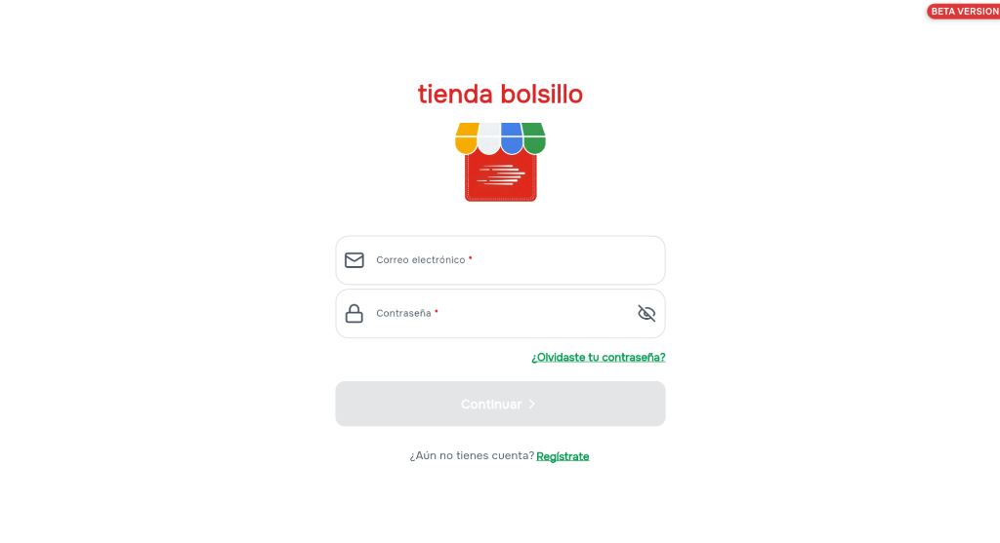
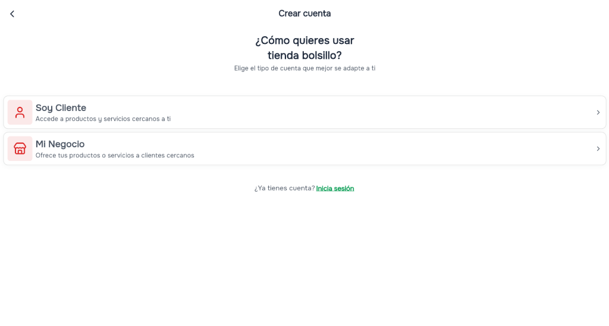
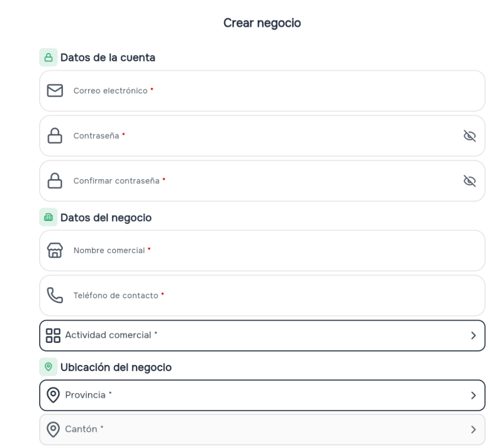
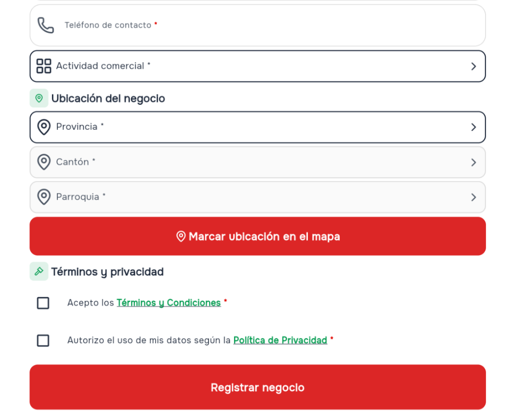
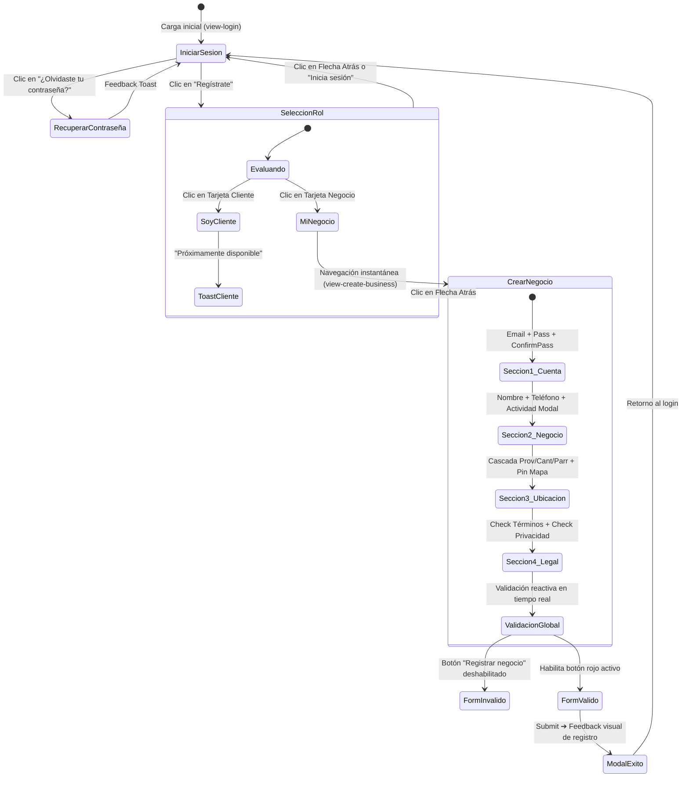
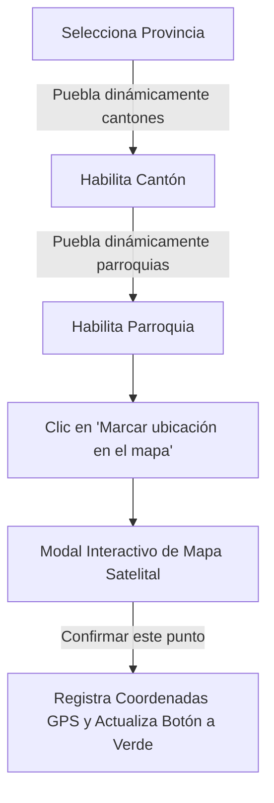

# 🛍️ Tienda Bolsillo — Ecosistema Web de Acceso y Registro (Beta)

> **Adaptación Web Oficial del Flujo de Autenticación y Registro de Negocios (Ferreterías, Farmacias y Comercios de Proximidad)**  
> Repositorio oficial: [https://github.com/diegotorres006/Login_Version_Beta_TiendaBolsillo](https://github.com/diegotorres006/Login_Version_Beta_TiendaBolsillo)

---

## 📌 1. Visión General del Proyecto

Este repositorio contiene la arquitectura de software frontend y el diseño de interfaz de usuario (UI/UX) para la versión web de **Tienda Bolsillo**, adaptando con fidelidad y mejoras de experiencia las 4 pantallas principales de la aplicación **Android Beta**:

1. **Iniciar Sesión (`view-login`)**: Acceso con credenciales, validación visual en tiempo real y recuperación de contraseña.
2. **Selección de Tipo de Cuenta (`view-role-selection`)**: Bifurcación entre *Soy Cliente* y *Mi Negocio*.
3. **Registro de Negocio (`view-create-business`)**: Formulario por secciones:
   - *Datos de la cuenta* (Correo y contraseñas con verificación en vivo).
   - *Datos del negocio* (Nombre comercial, teléfono y selector modal de actividad: ferretería, farmacia, etc.).
   - *Ubicación del negocio* (Selectores en cascada para **Ecuador**: Provincia ➔ Cantón ➔ Parroquia + Marcado interactivo de GPS en mapa).
   - *Términos y Privacidad* (Validación estricta con enlaces directos oficiales).

---

## 🎨 2. Justificación del Diseño: *"Entre minimalista y no tanto"*

El error típico al llevar una app móvil a la web es simplemente centrar la pantalla vertical en un monitor ancho, dejando grandes espacios vacíos que lucen fríos e incompletos.

Nuestra propuesta implementa una **Arquitectura Split-Screen Asimétrica y Adaptativa**:

* **Columna Izquierda (Brand & Trust Canvas - Desktop):**
  - Identidad visual oficial (toldo multicolor característico de Tienda Bolsillo).
  - Propuesta de valor clara enfocada en negocios de barrio (*Ferreterías, Farmacias, Minimarkets*).
  - Tarjetas flotantes con beneficios operacionales y enlaces legales permanentes.
* **Columna Derecha (Interactive Form Canvas):**
  - Contenedor limpio, espacioso y minimalista.
  - Microinteracciones agradables (borde de foco rojo `#e53935`, transiciones fluidas de 250ms, insignias esmeralda `#059669` para las secciones).
  - Componentes enriquecidos: toggle para visualizar contraseñas, modal de rubros comerciales y selector de coordenadas sobre mapa satelital simulado.
* **Comportamiento Móvil / Tablet:**
  - El split-screen se colapsa suavemente en una tarjeta centrada, manteniendo intacta la ergonomía táctil.

---

## 📸 3. Comparativa: Pantallas Originales Android Beta vs. Solución Web

| 1. Iniciar Sesión (Android) | 2. Selección de Rol (Android) | 3. Crear Negocio Parte 1 | 4. Crear Negocio Parte 2 |
| :---: | :---: | :---: | :---: |
|  |  |  |  |

---

## 🔄 4. Diagramas de Flujo y Máquina de Estados

### Diagrama de Navegación de Vistas (State Machine)



### Diagrama de Cascada Geográfica (Ecuador)



---

## 📋 5. Matriz Estricta de Validación Frontend

| Campo | Regla Técnica (Regex / Condición) | Evento | Comportamiento |
| :--- | :--- | :--- | :--- |
| **Correo electrónico** | `^[^\s@]+@[^\s@]+\.[^\s@]+$` | `input / blur` | Borde rojo en formato inválido; estado normal al cumplir RFC 5322. |
| **Contraseña** | Longitud $\ge 6$ caracteres | `input` | Botón con icono para alternar visibilidad (Show/Hide). |
| **Confirmar contraseña** | `pass === passConfirm` | `input` | Indicador visual: *"✓ Contraseñas coinciden"* o *"Las contraseñas no coinciden"*. |
| **Nombre comercial** | `string.trim().length >= 3` | `input` | Valida longitud mínima del nombre del comercio. |
| **Teléfono de contacto** | Formato numérico $\ge 7$ dígitos | `input` | Previene caracteres alfabéticos. |
| **Actividad comercial** | Selección modal requerida | `click` | Asigna categoría con icono (Ferretería, Farmacia, etc.). |
| **Cascada Geográfica** | Selección obligatoria (Provincia ➔ Cantón ➔ Parroquia) | `change` | Desbloqueo progresivo para evitar inconsistencias territoriales. |
| **Términos y Condiciones** | `checkbox.checked === true` | `change` | Enlace obligatorio: [`https://tiendabolsillo.com/terminos`](https://tiendabolsillo.com/terminos). |
| **Política de Privacidad** | `checkbox.checked === true` | `change` | Enlace obligatorio: [`https://tiendabolsillo.com/datos-personales`](https://tiendabolsillo.com/datos-personales). |

---

## 🔌 6. Contrato de Integración Frontend-Backend (API Payload)

Aunque este desarrollo es 100% frontend, el formulario está desacoplado y listo para consumir el endpoint backend:

```http
POST /api/v1/auth/register-business HTTP/1.1
Content-Type: application/json
```

```json
{
  "account": {
    "email": "ferreteria.central@ejemplo.com",
    "password": "hashed_or_raw_string"
  },
  "business": {
    "commercial_name": "Ferretería Central del Norte",
    "phone_contact": "0991234567",
    "commercial_activity": "ferreteria",
    "commercial_activity_label": "Ferretería y Materiales de Construcción"
  },
  "location": {
    "country": "Ecuador",
    "province": "Pichincha",
    "canton": "Quito",
    "parish": "Iñaquito",
    "coordinates": {
      "lat": -0.1807,
      "lng": -78.4678
    }
  },
  "compliance": {
    "accepted_terms": true,
    "accepted_privacy": true,
    "terms_version_url": "https://tiendabolsillo.com/terminos",
    "privacy_version_url": "https://tiendabolsillo.com/datos-personales",
    "registered_at": "2026-10-15T02:40:00Z"
  }
}
```

---

## 📂 7. Estructura del Código

```text
├── index.html              # Estructura semántica, accesibilidad y modales
├── css/
│   └── styles.css          # Variables CSS, sombras, animaciones y microinteracciones
├── js/
│   ├── ecuador-locations.js # Dataset jerárquico de Provincias, Cantones y Parroquias
│   └── app.js              # Máquina de estados, validaciones reactivas y toasts
├── assets/
│   └── screenshots/        # Capturas originales de la app Android Beta
├── PLANIFICACION_ARQUITECTURA_WEB_TIENDA_BOLSILLO.docx # Documentación técnica formal
└── README.md               # Este archivo de documentación técnica
```

---

## 🚀 8. Instrucciones para Ejecutar Localmente

1. Clona este repositorio o descarga los archivos:
   ```bash
   git clone https://github.com/diegotorres006/Login_Version_Beta_TiendaBolsillo.git
   ```
2. Entra a la carpeta del proyecto:
   ```bash
   cd Login_Version_Beta_TiendaBolsillo
   ```
3. Abre el archivo `index.html` en cualquier navegador web moderno (Google Chrome, Microsoft Edge, Firefox, Safari).
   * *No requiere Node.js, compiladores ni servidores backend para probar la interfaz completa.*
4. En la barra superior encontrarás un selector rápido para saltar entre las vistas durante presentaciones o demostraciones ante el equipo directivo.

---

## 👨‍💻 Autor

* **Juan Diego Torres Maldonado**  
* Estudiante en Prácticas Preprofesionales de Desarrollo de Software  
* Repositorio: [https://github.com/diegotorres006/Login_Version_Beta_TiendaBolsillo](https://github.com/diegotorres006/Login_Version_Beta_TiendaBolsillo)
